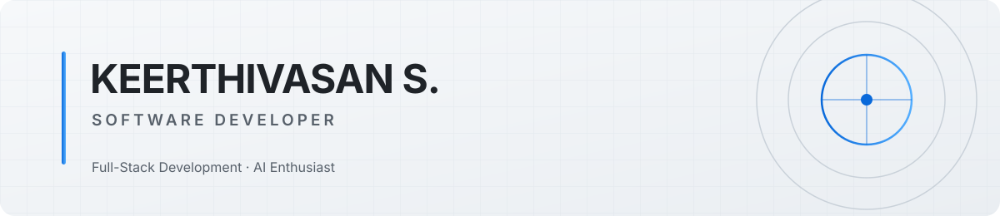

<!-- Header -->
<p align="center">
  
</p>

<p align="center">
  <a href="https://readme-typing-svg.demolab.com">
    
  </a>
</p>

<p align="center">
  <a href="https://www.linkedin.com/in/keerthivasan-sk"></a>
  <a href="https://keerthivasanportfolio.vercel.app/"></a>
  <a href="mailto:keerthivasan.skv1506@gmail.com"></a>
</p>

---

## About Me

I'm a B.Tech Information Technology student passionate about building practical software applications and solving real-world problems through technology. I enjoy exploring full-stack development, experimenting with modern frameworks, and integrating AI capabilities into applications. I'm continuously learning, building projects, and strengthening my software engineering skills.

<details>
  <summary><strong>Open my developer terminal</strong></summary>

```bash
$ whoami
Keerthivasan S.
B.Tech Information Technology Student

$ interests
Full-Stack Development
Artificial Intelligence
Software Engineering

$ currently_focusing_on
Building practical applications
Problem solving
Exploring AI-powered solutions
```
</details>

## Tech Stack

**Primary technologies**

<p>
  
</p>

**Familiar technologies & tools**

<p>
  
</p>

<sub>React Native uses the React ecosystem. Primary and familiar groups reflect my current experience, not proficiency scores.</sub>

## Featured Projects

<p align="center">
  <a href="https://github.com/KEERTHIVASAN-SKV/SportiZen">
    
  </a>
  <a href="https://github.com/KEERTHIVASAN-SKV/Quiz-Generator-app">
    
  </a>
  <a href="https://github.com/KEERTHIVASAN-SKV/DIPLOMAT">
    
  </a>
</p>

- **SportiZen** — A sports networking platform connecting players, coaches and organizations.  
  <sub>React · TypeScript · Supabase</sub>
- **QuizGen AI** — An application that integrates an LLM API to generate quiz content.  
  <sub>LLM API · Application Development</sub>
- **DIPLOMAT** — A contract-based validation gateway concept for AI agents in insurance claim workflows. This project is a work in progress.  
  <sub>Python · FastAPI · TypeScript · Pydantic</sub>

## Experience

**Software Development Intern · Bluestock Fintech**  
<sub>June – July 2025</sub>

- Worked on an IPO tracking and stock market analysis platform.
- Developed IPO listing interfaces and integrated APIs.
- Implemented access to RHP/DRHP documents.
- Contributed to the administrative Manage IPO functionality.

## GitHub Statistics

<p align="center">
  
</p>

## Contribution Activity

<p align="center">
  
</p>

---

<p align="center">
  <strong>Thanks for visiting my profile!</strong><br />
  <sub>Always learning. Always building.</sub>
</p>
